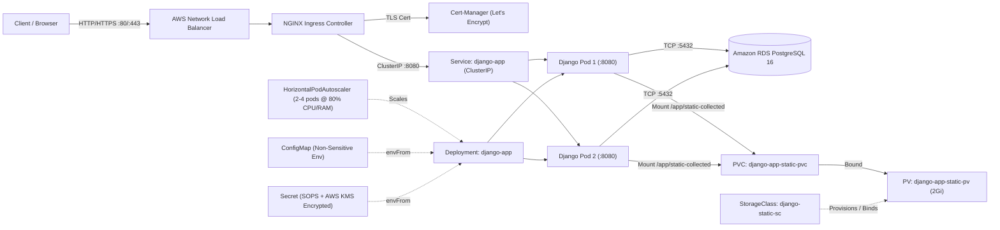

# Kubernetes & Helm Deployment for Django Application on AWS (EKS + RDS)

This repository contains a production-grade **Kubernetes** and **Helm / Helmfile** deployment solution for the **Healthchecks Django Application** (upstream: [`kaaalim/django-sample-app`](https://github.com/kaaalim/django-sample-app.git), containerized fork: [`musaxasmammedov7/django-sample-app-ecs-fargate`](https://github.com/musaxasmammedov7/django-sample-app-ecs-fargate)) running on **Amazon EKS (Elastic Kubernetes Service)** and backed by **Amazon RDS for PostgreSQL**.

---

## Repository Structure

```text
└── k8s_django_deployment_task
    ├── helm_chart
    │   ├── charts
    │   ├── templates
    │   │   ├── configmap.yaml
    │   │   ├── deployment.yaml
    │   │   ├── hpa.yaml
    │   │   ├── ingress.yaml
    │   │   ├── pv.yaml
    │   │   ├── pvc.yaml
    │   │   ├── secrets.yaml
    │   │   ├── service.yaml
    │   │   └── storage-class.yaml
    │   ├── .sops.yaml
    │   ├── Chart.yaml
    │   ├── secrets.values.yaml
    │   └── values.yaml
    ├── helmfile
    │   └── helmfile.yaml
    ├── terraform
    │   ├── main.tf
    │   └── outputs.tf
    ├── README.md
    └── documentation
        └── deployment_guide.md
```

---

## Architecture Overview



### Key Features Implemented

1. **Amazon EKS Cluster & Amazon RDS PostgreSQL (`terraform/`)**:
   - Dedicated VPC (`10.20.0.0/16`) across 2 Availability Zones in `eu-north-1` (`eu-north-1a`, `eu-north-1b`) with public and private subnets tagged for AWS Load Balancer auto-discovery.
   - **Amazon EKS v1.31** cluster (`django-k8s-cluster`) with a managed EC2 node group (`t3.medium` instances).
   - **Amazon RDS PostgreSQL 16** (`django-k8s-postgres`) hosted in private subnets, accessible only from the EKS VPC CIDR on port `5432`.
   - **Amazon ECR** repository (`669707688683.dkr.ecr.eu-north-1.amazonaws.com/django-sample-app`) storing the multi-stage hardened Django image.
   - **AWS KMS Key** (`alias/k8s-django-helm-secrets`) used to encrypt application secrets at rest in Git.

2. **Custom Application Helm Chart (`helm_chart/`)**:
   - **`templates/configmap.yaml`**: Injects non-sensitive environment variables (`DB`, `DB_HOST`, `DB_PORT`, `DB_NAME`, `DB_USER`, `DB_SSLMODE`, `DEBUG`, `ALLOWED_HOSTS`, `SITE_ROOT`, `PORT="8080"`).
   - **`templates/secrets.yaml` & `secrets.values.yaml`**: Injects sensitive credentials (`SECRET_KEY`, `DB_PASSWORD`). Encrypted using **`helm-secrets` + Mozilla SOPS + AWS KMS**.
   - **`templates/deployment.yaml`**:
     - Runs **2 replicas** by default (`replicaCount: 2`).
     - Operates on **port `8080`** (`--bind 0.0.0.0:8080`).
     - Propagates both `ConfigMap` and `Secret` via `envFrom`.
     - Configures HTTP **`livenessProbe`** and **`readinessProbe`** against `/api/v3/status/` on port `8080`.
     - Includes SHA-256 checksum annotations so pods automatically roll when `ConfigMap` or `Secret` values change.
   - **`templates/service.yaml`**: Exposes the pods internally within the cluster via a **`ClusterIP`** service on port `8080`.
   - **`templates/ingress.yaml`**:
     - Configures an `Ingress` resource using the `nginx` Ingress class backed by an **AWS Network Load Balancer (NLB)**.
     - Provisions a **Cert-Manager `ClusterIssuer`** (`letsencrypt-prod`) using ACME HTTP-01 challenge to automatically issue and renew a **Let's Encrypt** TLS certificate.
   - **`templates/hpa.yaml`**: Configures an `autoscaling/v2` **`HorizontalPodAutoscaler`** that scales the Deployment between **2 and 4 replicas** whenever average **CPU or Memory utilization reaches 80%**.
   - **`templates/storage-class.yaml`, `templates/pv.yaml` & `templates/pvc.yaml`**:
     - Defines a **`StorageClass`** (`django-static-sc`), a **`PersistentVolume`** (`django-app-static-pv`, `2Gi`), and a **`PersistentVolumeClaim`** (`django-app-static-pvc`) attached to the Django pods at `/app/static-collected` to persist the application's static files across pod restarts and rescheduling.
     - Uses an `initContainer` (`init-static-files`) in `deployment.yaml` to sync pre-compiled static assets into the persistent volume before Gunicorn starts.

3. **Declarative Environment Orchestration (`helmfile/helmfile.yaml`)**:
   - Deploys the entire stack in dependency order with a single command:
     1. `metrics-server` (`kube-system`)
     2. `ingress-nginx` (`ingress-nginx`, provisioning the AWS NLB)
     3. `cert-manager` (`cert-manager`, with CRDs installed)
     4. `django-app` (`django-app`, decrypting `secrets.values.yaml` via `helm-secrets`)

---

## Quick Start

### 1. Provision AWS Infrastructure (EKS, RDS, ECR, KMS)
```bash
cd terraform
terraform init
terraform apply -auto-approve
aws eks update-kubeconfig --region eu-north-1 --name django-k8s-cluster
```

### 2. Manage Encrypted Secrets (`helm-secrets` + SOPS + AWS KMS)
```bash
# View decrypted secrets in stdout without writing plaintext to disk
helm secrets decrypt helm_chart/secrets.values.yaml

# Edit encrypted secrets in-place
helm secrets edit helm_chart/secrets.values.yaml
```

### 3. Deploy Full Environment via Helmfile
```bash
cd helmfile
helmfile apply
```

### 4. Verify Deployment
```bash
kubectl get pods,svc,ingress,hpa -n django-app
kubectl get clusterissuer,certificate -A
```

---

## Why Kubernetes and Helm Are Beneficial in This Scenario

### Why Kubernetes?
1. **Self-Healing & Zero-Downtime High Availability**: Running 2+ replicas across multiple Availability Zones ensures that if a container crashes (detected by `livenessProbe`) or a worker node fails, Kubernetes automatically reschedules the pod while `readinessProbe` prevents routing user traffic to unready containers during database migrations or startup.
2. **Automated Horizontal Scaling (HPA)**: Traffic to health-monitoring platforms can spike unpredictably. The `HorizontalPodAutoscaler` monitors real-time CPU and RAM metrics and scales replicas from 2 to 4 automatically at the 80% threshold, then scales back down to save compute costs.
3. **Clean Separation of Stateless Compute & Stateful Storage**: Stateless Django web workers scale freely inside EKS while stateful relational data stays safely managed in **Amazon RDS PostgreSQL** (with automated backups, encryption, and patching).
4. **Cloud-Native Networking & Automated TLS**: Kubernetes integrates natively with AWS Load Balancers via the Ingress Controller and automates HTTPS certificate issuance and renewal via **Cert-Manager** and **Let's Encrypt**.

### Why Helm & Helmfile?
1. **DRY, Parameterized Packaging**: Instead of maintaining duplicated raw YAML manifests across `dev`, `staging`, and `prod`, a single Helm chart (`helm_chart/`) templates all 6 Kubernetes resource types (`Deployment`, `Service`, `Ingress`, `ConfigMap`, `Secret`, `HPA`) and injects environment-specific settings from `values.yaml`.
2. **Secure GitOps Secret Management (`helm-secrets` + SOPS)**: Standard Kubernetes Secrets are merely Base64-encoded. By combining `helm-secrets` with Mozilla SOPS and AWS KMS, sensitive values (`DB_PASSWORD`, `SECRET_KEY`) are strongly encrypted (`AES256_GCM`) inside Git and decrypted only in memory during deployment.
3. **One-Command Full-Stack Lifecycle (`helmfile`)**: `helmfile.yaml` codifies the entire cluster state—cluster add-ons (`metrics-server`, `ingress-nginx`, `cert-manager`) and the application chart—into a single declarative file with explicit dependency ordering (`needs:`).

---

## Detailed Documentation

For a complete walkthrough of all steps, Kubernetes/Helm concepts, commands executed, verification outputs, and troubleshooting of issues faced during implementation, see:
👉 **[`documentation/deployment_guide.md`](documentation/deployment_guide.md)**
