# Kubernetes Audit Logging & Security Analysis with the ELK Stack

This repository delivers a production-ready, enterprise-grade **Kubernetes API Server Audit Logging and Analysis System** built on top of the **ELK Stack (Elasticsearch, Logstash, Kibana, Filebeat)**. It satisfies all compliance requirements (SOC 2, PCI DSS 4.0, ISO 27001) for capturing, retaining, enriching, and investigating Kubernetes API activity.

---

## 1. Architecture Overview

```mermaid
flowchart LR
    User["Client / Attacker / ServiceAccount"] -->|HTTPS API Requests| APIServer["kube-apiserver"]
    APIServer -->|Evaluates Policy| Policy["Audit Policy\n(audit-policy.yaml)"]
    Policy -->|Writes JSON Events| AuditLog["/var/log/kubernetes/audit/audit.log\n(Control Plane Host Disk)"]
    
    subgraph Logging Pipeline ["ELK Security Ingestion Pipeline"]
        Filebeat["Filebeat DaemonSet\n(values/filebeat.yaml)"] -->|Harvests Log Stream| Logstash["Logstash Pipeline\n(values/logstash-config.yaml)"]
        Logstash -->|JSON Parsing + Threat Tagging| Elastic["Elasticsearch Cluster\n(values/elasticsearch.yaml)"]
        Elastic -->|Index: k8s-audit-*| Kibana["Kibana SIEM Dashboards\n(values/kibana.yaml)"]
    end
    
    AuditLog --> Filebeat
    Kibana -->|SOC Investigation & Threat Alerts| Analyst["Security Analyst / DevOps"]
```



---

## 2. Importance and Benefits of Audit Logging in Kubernetes

The `kube-apiserver` is the central control plane component through which **all** operational, administrative, and automated interactions take place. Operating a Kubernetes cluster without API auditing creates a blind spot.

### 2.1 Core Benefits
1. **Forensic Accountability & Attribution:**
   - Every API request records the requesting actor (`user.username`), their authentication groups, client IP (`sourceIPs`), user-agent, requested resource, HTTP verb (`get`, `create`, `delete`), and the final authorization decision (`200 OK` vs `403 Forbidden`).
2. **Detection of Compromised Credentials & Lateral Movement:**
   - Attackers who obtain a leaked `ServiceAccount` token or kubeconfig immediately perform discovery (`kubectl get secrets`, `kubectl auth can-i`). Audit logs expose anomalous spikes in `403 Forbidden` responses.
3. **Privilege Escalation & Tampering Visibility:**
   - Tracks modifications to critical RBAC objects (`ClusterRole`, `ClusterRoleBinding`) and attempts to schedule containers with dangerous capabilities or `hostPath` mounts.
4. **Regulatory Compliance:**
   - Meets mandatory audit trail requirements for **PCI DSS v4.0 (Req 10)**, **HIPAA (§ 164.312(b))**, and **SOC 2 (Trust Services Criteria CC6/CC7)**, requiring an immutable, non-repudiable audit log kept for at least 90–365 days.

---

## 3. Kubernetes Audit Policy Configuration (`audit-policy.yaml`)

Audit volume can quickly grow to tens of gigabytes per day in high-scale clusters. The policy defined in [`audit-policy.yaml`](audit-policy.yaml) adheres to the **CIS Kubernetes Benchmark**, striking the optimal balance between high security fidelity and log volume hygiene.

### 3.1 Audit Levels Defined in Policy
* **`None` (Dropped):** High-frequency health probes (`/healthz`, `/livez`, `/readyz`, `/version`), lease updates (`coordination.k8s.io/leases`), and internal `kube-proxy` endpoint watches are filtered out at the source.
* **`RequestResponse` (Full Payload):**
  - **Secrets & ConfigMaps:** Full request and response bodies are captured to record exactly what configurations were viewed or altered.
  - **RBAC Objects (`roles`, `rolebindings`, `clusterrolebindings`):** Logged with full bodies to catch privilege escalation attempts.
  - **Workload Mutating Operations (`pods/exec`, `pods/portforward`, `create`, `patch`, `delete`):** Full details captured when processes interact interactively with running containers.
* **`Metadata` (Headers Only):** Core read operations (`list`, `get`, `watch` on pods, services, nodes) capture caller identity, source IP, and timestamp without bloating storage with large workload specs.

### 3.2 Activating the Audit Policy on `kube-apiserver`
On self-managed Kubernetes control planes, configure `/etc/kubernetes/manifests/kube-apiserver.yaml`:

```yaml
spec:
  containers:
    - command:
        - kube-apiserver
        - --audit-policy-file=/etc/kubernetes/audit-policy.yaml
        - --audit-log-path=/var/log/kubernetes/audit/audit.log
        - --audit-log-maxage=30
        - --audit-log-maxbackup=10
        - --audit-log-maxsize=100
      volumeMounts:
        - mountPath: /etc/kubernetes/audit-policy.yaml
          name: audit-policy
          readOnly: true
        - mountPath: /var/log/kubernetes/audit
          name: audit-logs
  volumes:
    - hostPath:
        path: /etc/kubernetes/audit-policy.yaml
        type: File
      name: audit-policy
    - hostPath:
        path: /var/log/kubernetes/audit
        type: DirectoryOrCreate
      name: audit-logs
```

*(For Managed AWS EKS, control plane audit logs are enabled via CloudWatch Control Plane Logging with the `audit` flag enabled).*

---

## 4. Log Analysis System: ELK Stack Configuration

The analysis pipeline is deployed via official Elastic Helm charts with production configurations:

### 4.1 Filebeat DaemonSet ([`values/filebeat.yaml`](values/filebeat.yaml))
* **Target:** Scheduled onto control-plane nodes using `nodeSelector: node-role.kubernetes.io/control-plane: ""` and matching tolerations.
* **Function:** Mounts `/var/log/kubernetes/audit/` read-only and streams lines in real time to Logstash via the Beats protocol (TCP :5044).

### 4.2 Logstash Parsing Pipeline ([`values/logstash-config.yaml`](values/logstash-config.yaml))
* **JSON Decoding:** Parses raw Kubernetes audit JSON events.
* **Timestamp Normalization:** Maps `requestReceivedTimestamp` into `@timestamp`.
* **Automated Threat Tagging:**
  - `responseStatus.code in [401, 403]` $\rightarrow$ Tag: `security_alert_unauthorized`
  - `objectRef.resource == "secrets"` $\rightarrow$ Tag: `security_alert_secret_access`
  - `objectRef.subresource in ["exec", "attach"]` $\rightarrow$ Tag: `security_alert_container_exec`
  - `objectRef.apiGroup == "rbac.authorization.k8s.io"` $\rightarrow$ Tag: `security_alert_rbac_change`

### 4.3 Elasticsearch ([`values/elasticsearch.yaml`](values/elasticsearch.yaml))
* Multi-node cluster with persistent SSD storage (`gp3`), JVM heap tuning (`-Xms1g -Xmx1g`), and automated index rollover (`k8s-audit-YYYY.MM.dd`).

### 4.4 Kibana ([`values/kibana.yaml`](values/kibana.yaml))
* Exposes investigative dashboards, KQL search queries, and real-time visualization over Ingress with TLS.

---

## 5. Hypothetical Suspicious Activity Scenario & Forensic Analysis

### 5.1 The Scenario: Compromised CI/CD ServiceAccount
* **Context:** An external attacker compromises an API token belonging to an internal continuous integration ServiceAccount (`ci-deployer`) in the `default` namespace.
* **Attacker's Objective:** Escalate privileges to cluster administrator, exfiltrate database credentials from production secrets, and establish persistence via a rogue privileged daemonset.

---

### 5.2 Phase 1: Reconnaissance & Access Denied (Audit Log Evidence)
The attacker attempts to enumerate cluster-wide Secrets:

```json
{
  "kind": "Event",
  "apiVersion": "audit.k8s.io/v1",
  "level": "Metadata",
  "auditID": "a1b2c3d4-e5f6-7890-abcd-ef1234567890",
  "stage": "ResponseComplete",
  "requestURI": "/api/v1/namespaces/kube-system/secrets",
  "verb": "list",
  "user": {
    "username": "system:serviceaccount:default:ci-deployer",
    "uid": "88776655-4433-2211-00aa-bbccddeeff00",
    "groups": ["system:serviceaccounts", "system:serviceaccounts:default", "system:authenticated"]
  },
  "sourceIPs": ["198.51.100.45"],
  "userAgent": "kubectl/v1.30.0 (darwin/arm64) kubernetes/7d4f5b4",
  "objectRef": {
    "resource": "secrets",
    "namespace": "kube-system",
    "apiVersion": "v1"
  },
  "responseStatus": {
    "metadata": {},
    "status": "Failure",
    "message": "secrets is forbidden: User \"system:serviceaccount:default:ci-deployer\" cannot list resource \"secrets\" in API group \"\" in the namespace \"kube-system\"",
    "reason": "Forbidden",
    "code": 403
  },
  "requestReceivedTimestamp": "2026-10-27T14:15:22.451000Z",
  "stageTimestamp": "2026-10-27T14:15:22.453200Z"
}
```

---

### 5.3 Phase 2: Attempted Privilege Escalation via RBAC
Failing to read secrets directly, the attacker attempts to create a `ClusterRoleBinding` binding `ci-deployer` to `cluster-admin`:

```json
{
  "kind": "Event",
  "apiVersion": "audit.k8s.io/v1",
  "level": "RequestResponse",
  "auditID": "f9e8d7c6-b5a4-3210-fedc-ba9876543210",
  "stage": "ResponseComplete",
  "requestURI": "/apis/rbac.authorization.k8s.io/v1/clusterrolebindings",
  "verb": "create",
  "user": {
    "username": "system:serviceaccount:default:ci-deployer",
    "groups": ["system:serviceaccounts", "system:authenticated"]
  },
  "sourceIPs": ["198.51.100.45"],
  "userAgent": "kubectl/v1.30.0",
  "objectRef": {
    "apiGroup": "rbac.authorization.k8s.io",
    "apiVersion": "v1",
    "resource": "clusterrolebindings",
    "name": "backdoor-admin"
  },
  "responseStatus": {
    "status": "Failure",
    "message": "clusterrolebindings.rbac.authorization.k8s.io is forbidden: User \"system:serviceaccount:default:ci-deployer\" cannot create resource \"clusterrolebindings\" in API group \"rbac.authorization.k8s.io\" at the cluster scope",
    "code": 403
  },
  "requestReceivedTimestamp": "2026-10-27T14:17:05.102000Z"
}
```

---

### 5.4 How We Analyzed It in Kibana

The SOC analyst investigates via Kibana using the pre-configured index pattern `k8s-audit-*`:

#### Step 1: Detect the Anomaly Spike
* **KQL Filter:**
  ```text
  tags: "security_alert_unauthorized" AND k8s_status_code: 403
  ```
* **Observation:** A sudden spike of twenty `403 Forbidden` errors originating from an external IP `198.51.100.45` using `system:serviceaccount:default:ci-deployer`. Legitimate CI runners operate strictly inside private AWS subnets (`10.20.0.0/16`), revealing that the source IP is external.

#### Step 2: Trace the Actor's Complete Timeline
* **KQL Filter:**
  ```text
  k8s_user: "system:serviceaccount:default:ci-deployer"
  ```
* Visualizing the timeline shows:
  1. `14:15:22` — `LIST` `secrets` in `kube-system` $\rightarrow$ `403 Forbidden`
  2. `14:16:10` — `LIST` `configmaps` in `kube-system` $\rightarrow$ `403 Forbidden`
  3. `14:17:05` — `CREATE` `clusterrolebindings` $\rightarrow$ `403 Forbidden`
  4. `14:18:40` — `GET` `pods` in `default` $\rightarrow$ `200 OK` (Enumeration succeeded)

---

### 5.5 Containment & Remediation Actions Taken

1. **Immediate Revocation:**
   - Deleted the compromised ServiceAccount token secret and deleted the `ci-deployer` ServiceAccount to invalidate all active API sessions:
     ```bash
     kubectl delete sa ci-deployer -n default
     ```
2. **IP Blacklisting:**
   - Blocked source IP `198.51.100.45` at the AWS VPC Network ACL and Security Group level.
3. **CI/CD Secret Rotation:**
   - Rotated the underlying Git tokens and inspected CI runners for token leakage.
4. **Automated SIEM Alert Rule:**
   - Created an Elasticsearch Watcher alert triggering a Slack/PagerDuty notification whenever more than five `403 Forbidden` events occur from a single ServiceAccount within two minutes.
